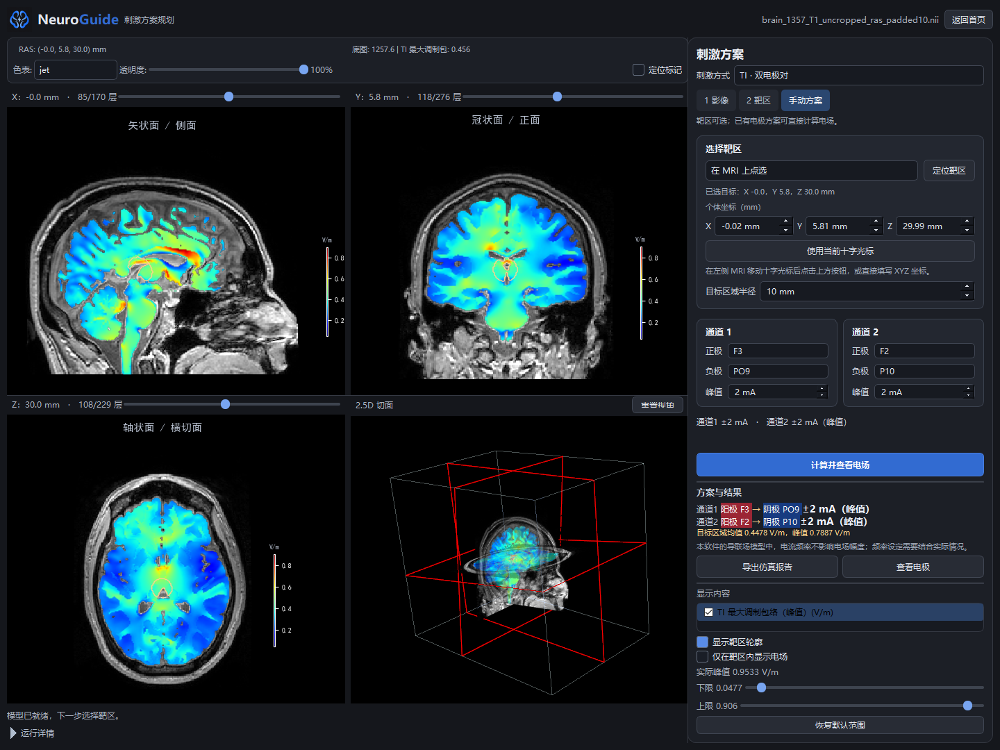
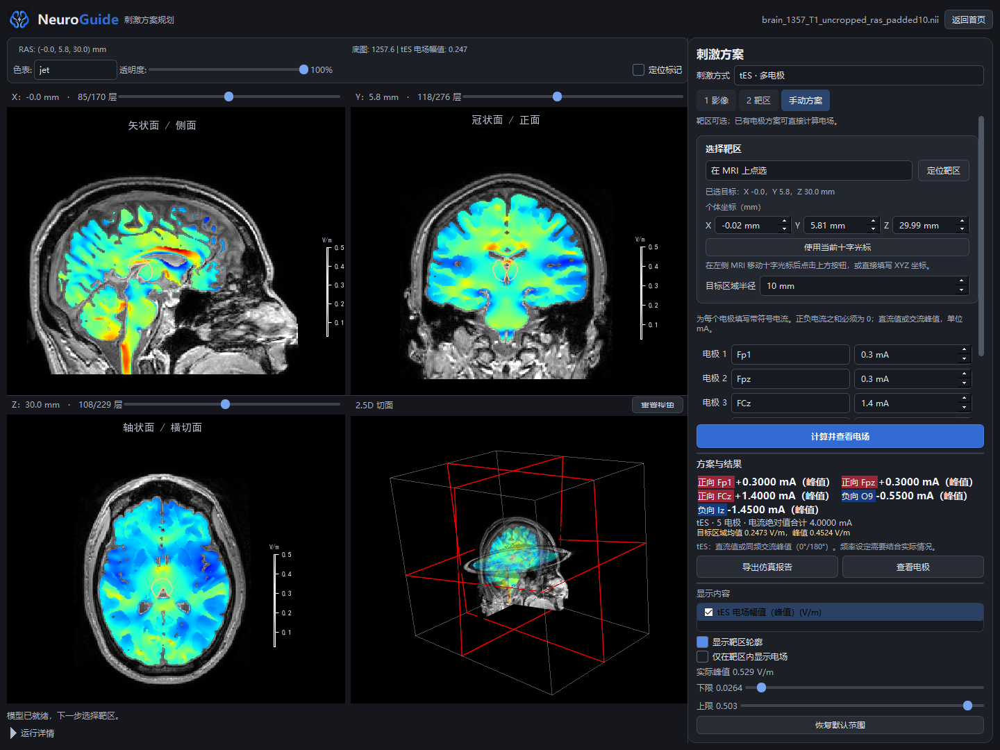

<div align="center">
  
  <h1>NeuroGuide</h1>
  <p>个体 MRI 电场仿真与 TI / tES 方案规划</p>
  <p>Windows 桌面软件 · V4.5</p>
</div>

NeuroGuide 面向医生和研究人员，用于根据个体 T1 MRI 建立头部电场模型，规划 TI / tES 电极方案，并查看、比较仿真结果。影像导入、靶区选择、电场计算和报告导出均可在软件中完成。

## 为什么使用 NeuroGuide

**精准：围绕个体解剖和目标区域规划方案。** 使用患者本人的 MRI 构建头部模型，结合靶区、电极位置和电流约束进行优化。算法先搜索候选方案，再以完整计算结果复核，使方案评价落实到个体电场分布和靶区统计。

**快速：以 BrainLFNet 加速电场计算。** BrainLFNet 相比传统有限元方法（FEM）的电场计算加速达到 **107 倍**，便于反复比较电极组合和电流设置。该倍数对应模型的性能对比；实际使用中的影像处理、模型准备和方案优化耗时，还取决于数据规模、硬件及参数设置。

**易用：从导入影像到导出报告，在一个界面中完成。** 分发版已配齐运行环境，省去安装、配置底层有限元求解工具的步骤。低显存推理降低 GPU 显存需求，必要时可回退 CPU；已有个体模型可以复用，方便继续调整靶区和刺激方案。

## 界面预览

### TI 电场仿真

在同一工作区查看三方向 MRI、电场叠加和 2.5D 切面，结合右侧的电极、电流及靶区统计比较方案。



### tES 多电极方案

逐电极设置电流，并查看对应的电场分布与靶区结果。



*截图用于展示软件功能，图中的电极、电流和统计值为示例方案。*

## 下载与使用

**[夸克网盘下载 Windows 版](https://pan.quark.cn/s/7c774f15b867)**

下载密码请联系 **[xuxie@zju.edu.cn](mailto:xuxie@zju.edu.cn)** 获取。

完整解压后，双击 `NeuroGuide-V4.5.exe` 启动。请保留解压目录中的全部文件。软件已配备 Python 运行环境、推理依赖和模型资源，可直接使用。

详细步骤见 [医生使用手册](docs/使用说明_V4.5_医生版.txt)，软件文件夹中也附有 `使用说明.txt`。

## 主要功能

| 功能 | 说明 |
| --- | --- |
| 影像导入 | 读取 `.nii`、`.nii.gz` 格式的 T1 MRI，或选择 DICOM 序列进行转换 |
| 个体建模 | 完成组织处理、电极定位和导联场计算，支持已有模型复用 |
| 靶区选择 | 在 MRI 上点选、输入个体 RAS 坐标，或通过 AAL3 图谱选择一个或多个脑区 |
| TI 方案规划 | 自动搜索双电极对方案，也可手动设置电极对及各通道电流 |
| tES 方案规划 | 自动搜索多电极方案，支持逐电极电流设置、电流平衡及约束检查 |
| 电场显示 | 查看三方向 MRI 切片、2.5D 切面、电场分布、靶区统计和电极示意图 |
| 报告导出 | 将患者信息、靶区、电极、电流、统计结果和影像切片保存为 PDF |
| 患者记录 | 在本机管理基本信息，并在导出报告时关联记录 |

分发版附有参考 MRI，可用于熟悉操作和演示。评估个体方案时，请导入对应患者的影像。

## 操作流程

1. 启动软件，点击 **新建刺激方案**。
2. 在 **1 影像** 中选择 T1 MRI，或点击 **导入 DICOM…**。
3. 核对患者信息，浏览影像的覆盖范围、质量和方向，点击 **生成电场模型**。
4. 模型就绪后，选择 **TI** 或 **tES**，在 **2 靶区** 中确定目标区域。
5. 点击 **自动规划并查看电场**；已有方案可在 **手动方案** 中输入后计算。
6. 查看电场、靶区统计和电极位置，导出仿真报告。

### 导入 DICOM

选择影像文件夹后，软件会列出其中的序列，显示患者、检查日期、序列描述、模态、文件数等信息，并提供样本预览。

请结合原始检查资料选择 T1 结构像，勾选确认框，再点击 **转换并载入所选序列**。序列类型由医生判断；更换序列后需重新确认。若转换工具报告警告，或同一序列产生多份可用影像，软件会提示进一步核查。

转换在本机完成，原始 DICOM 保留。载入后请浏览完整影像，再开始建模。样本预览仅用于辅助识别序列，影像方向和头部覆盖范围应在主界面核对。更多说明见 [DICOM 导入](docs/dicom_import.md)。

## BrainLFNet 发布说明

NeuroGuide 的个体建模与导联场推理依赖 BrainLFNet。**相关论文尚未发表，BrainLFNet 的代码、权重和配套资源暂缓公开。** [BrainLFNet 目录](BrainLFNet/README.md) 中保留了简短说明，后续发布安排将在仓库更新。

当前公开部分包括桌面界面、流程管理、DICOM 导入、TI / tES 合成与优化、可视化、报告及构建工具。源码运行完整流程还需配齐 BrainLFNet 和相应运行资源；希望直接使用软件，可下载上方 Windows 分发版。

## 源码开发

```text
main.py                 程序入口
core/                   影像处理、任务管理、TI / tES 计算与缓存
ui/                     影像工作区、方案设置和结果显示
BrainLFNet/             模型模块发布说明
tools/                  后台任务、报告与构建工具
tests/                  回归测试
assets/branding/        软件 Logo 与版本信息
docs/                   使用手册及开发说明
NeuroGuide_revise.spec   PyInstaller 打包配置
```

当前 Windows 分发版使用 Python 3.10，GPU 推理环境为 PyTorch 2.7.1 / CUDA 12.8。开发时建议使用独立虚拟环境：

```powershell
git clone https://github.com/qaas-bci-lab/NeuroGuide.git
cd NeuroGuide
py -3.10 -m venv .venv
.\.venv\Scripts\python.exe -m pip install -r requirements-individual.txt
```

完成 Python 依赖安装后，请按 [运行资源说明](docs/source_resources.md) 配置模型、图谱、参考影像和 DICOM 转换工具。资源齐全后运行：

```powershell
.\.venv\Scripts\python.exe main.py
```

`requirements-cu128.txt` 对应 CUDA 12.8 构建环境，请根据自己的显卡和运行环境选择依赖。完整推理、图谱和影像相关测试也需要相应资源。

### 打包

V4.5 通过 Cython 将项目模块编译为原生扩展，再由 PyInstaller 打包。构建入口为 `tools/build_protected.py`，依赖见 `requirements-build-protected.txt`。构建需要 Windows x64、匹配的 MSVC C++ 工具链及完整运行资源。

原生编译用于提高代码保护程度，专业逆向仍有可能；模型权重按原有格式分发。第三方组件的许可和版权声明应随软件保留。

## 使用说明

NeuroGuide 的结果用于电场仿真和方案评估。实际刺激需另行配置设备，并按所在机构的诊疗或研究流程核定电极、电流、频率及持续时间。软件默认参数仅为初始设置，结果的解释应结合影像质量、模型适用性和具体应用场景。

当前 TI 界面提供电极与通道电流设置；tES 采用直流或同频 0°/180° 相位交流的幅值模型。疗效及实际刺激安全性需要独立评估。

患者记录、转换影像和仿真结果保存在本机，请按所在机构的数据管理要求妥善保管，并在选择影像和导出报告时核对患者归属。

## 联系

软件使用、下载密码及项目交流：**[xuxie@zju.edu.cn](mailto:xuxie@zju.edu.cn)**。
